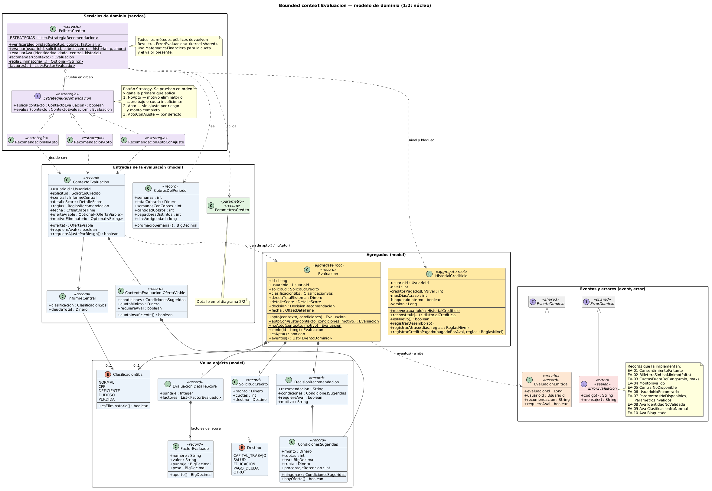
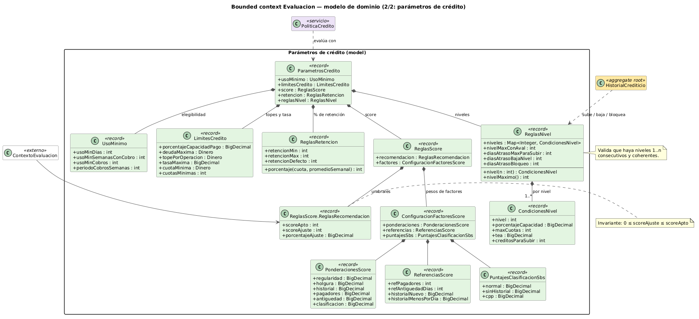

# Bounded context Evaluacion — diagrama de clases del dominio

Representa las clases de `com.projects.kapikua_api.evaluacion.domain` (`model`, `service`, `event`, `error`) y los tipos del kernel `shared` que estas usan.

## Diagrama 1/2: núcleo

Muestra el servicio `PoliticaCredito` y las estrategias de recomendación, las entradas de la evaluación (`ContextoEvaluacion`, `InformeCentral`, `CobrosDelPeriodo`), los dos agregados (`Evaluacion`, `HistorialCrediticio`), sus value objects, el evento `EvaluacionEmitida` y la jerarquía de errores `ErrorEvaluacion`.

## Diagrama 2/2: parámetros de crédito

Detalla `ParametrosCredito` y los records que lo componen: uso mínimo, límites, retención, niveles y reglas de score.

## Por qué un diagrama de clases UML en PlantUML

La petición es estructural: tipos, atributos, métodos y relaciones entre ellos. PlantUML da notación UML estándar (composición, agregación, realización, dependencia) y estereotipos para marcar roles de DDD.

## Decisiones de diseño

- **Dos diagramas en vez de uno.** Con las 26 clases en una sola vista, el diagrama medía unos 5600 px de ancho. Al separar los parámetros, ambos se pueden leer.
- **Colores por rol DDD:** amarillo = aggregate root, azul = value object / record, verde = parámetros, lila = servicios y estrategias, naranja = evento, rojo = error, gris = kernel `shared`.
- **Relaciones:** composición (`*--`) cuando el record contiene al otro como parte de su valor; dependencia (`..>`) cuando solo lo usa en un método.
- **Flechas omitidas a propósito:** `Dinero`, `UsuarioId`, `Result` y `MatematicaFinanciera` aparecen como tipos o en notas, sin flechas, para no cruzar todo el diagrama. Tampoco se dibujan las referencias de `ContextoEvaluacion` a `SolicitudCredito`, `DetalleScore` y `ReglasRecomendacion`; salen en sus atributos.
- **Los 12 records de `ErrorEvaluacion`** se listan en una nota con su código (EV-01 … EV-10) en lugar de dibujar una caja por cada uno.

## Supuestos

- Los records anidados (`Evaluacion.DetalleScore`, `ContextoEvaluacion.OfertaViable`, `ReglasScore.ReglasRecomendacion` y los tres de `ConfiguracionFactoresScore`) se dibujan como clases aparte, unidas por composición a la clase que los contiene.
- La multiplicidad "6" de `FactorEvaluado` corresponde a los seis factores fijos que construye `PoliticaCredito.factores(...)`.

## Archivos

- `evaluacion-domain-clases.puml` / `.png` / `.svg`
- `evaluacion-domain-parametros.puml` / `.png` / `.svg`
